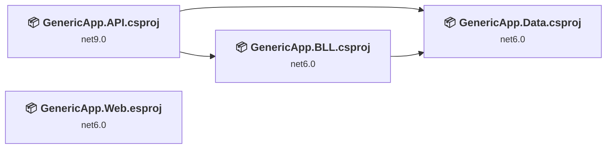
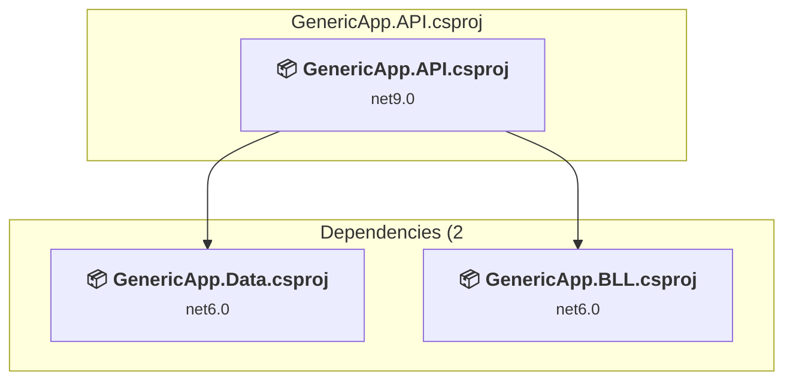
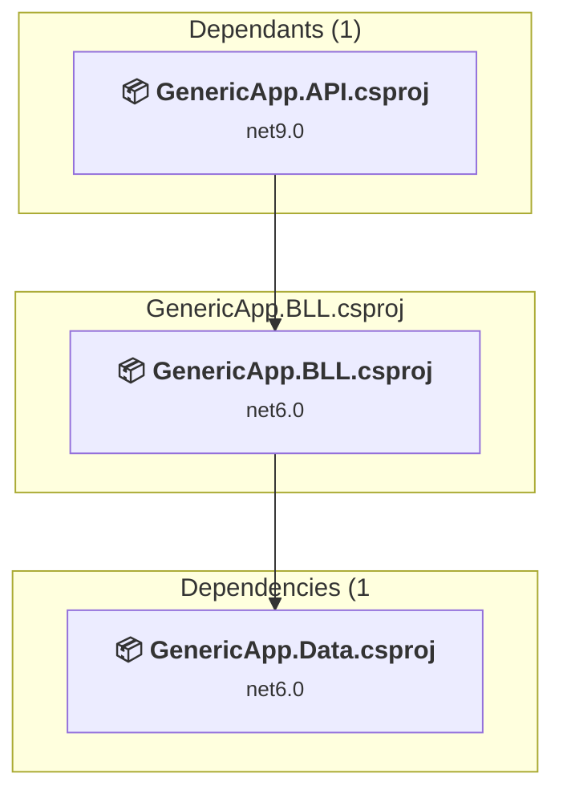
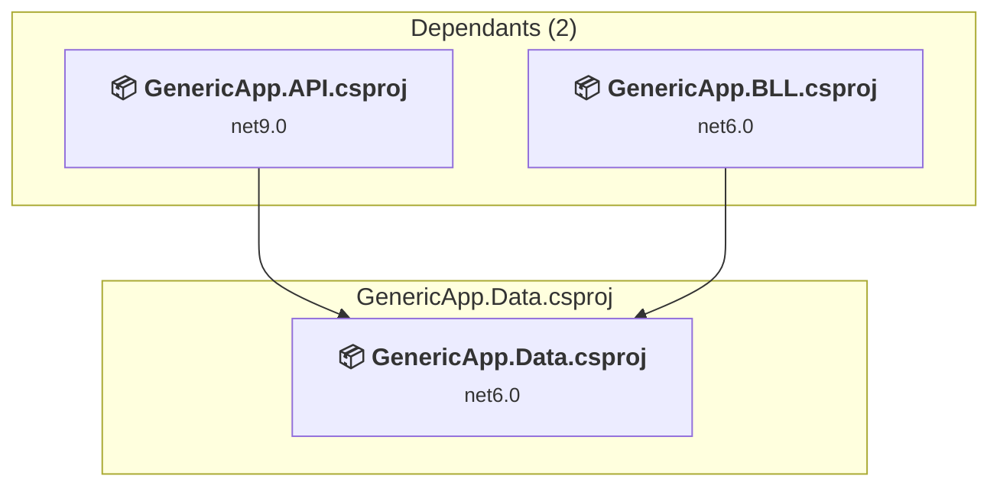
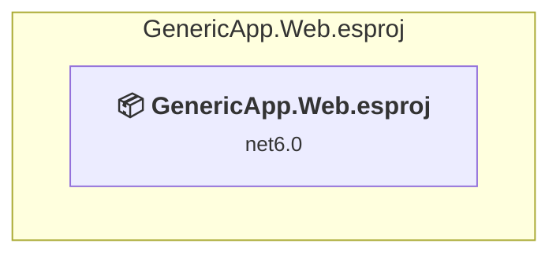

# Projects and dependencies analysis

This document provides a comprehensive overview of the projects and their dependencies in the context of upgrading to .NETCoreApp,Version=v10.0.

## Table of Contents

- [Executive Summary](#executive-Summary)
  - [Highlevel Metrics](#highlevel-metrics)
  - [Projects Compatibility](#projects-compatibility)
  - [Package Compatibility](#package-compatibility)
  - [API Compatibility](#api-compatibility)
  - [Binding Redirect Configuration](#binding-redirect-configuration)
- [Aggregate NuGet packages details](#aggregate-nuget-packages-details)
- [Top API Migration Challenges](#top-api-migration-challenges)
  - [Technologies and Features](#technologies-and-features)
  - [Most Frequent API Issues](#most-frequent-api-issues)
- [Projects Relationship Graph](#projects-relationship-graph)
- [Project Details](#project-details)

  - [GenericApp.API\GenericApp.API.csproj](#genericappapigenericappapicsproj)
  - [GenericApp.BLL\GenericApp.BLL.csproj](#genericappbllgenericappbllcsproj)
  - [GenericApp.Data\GenericApp.Data.csproj](#genericappdatagenericappdatacsproj)
  - [GenericApp.Web\GenericApp.Web.esproj](#genericappwebgenericappwebesproj)

## Executive Summary

### Highlevel Metrics

| Metric | Count | Status |
| :--- | :---: | :--- |
| Total Projects | 4 | All require upgrade |
| Total NuGet Packages | 158 | 9 need upgrade |
| Total Code Files | 183 |  |
| Total Code Files with Incidents | 9 |  |
| Total Lines of Code | 120744 |  |
| Total Number of Issues | 56 |  |
| Estimated LOC to modify | 36+ | at least 0.0% of codebase |

### Projects Compatibility

| Project | Target Framework | Difficulty | Package Issues | API Issues | Binding Issues | Est. LOC Impact | Description |
| :--- | :---: | :---: | :---: | :---: | :---: | :---: | :--- |
| [GenericApp.API\GenericApp.API.csproj](#genericappapigenericappapicsproj) | net9.0 | 🟢 Low | 7 | 33 | 0 | 33+ | AspNetCore, Sdk Style = True |
| [GenericApp.BLL\GenericApp.BLL.csproj](#genericappbllgenericappbllcsproj) | net6.0 | 🟢 Low | 2 | 0 | 0 |  | ClassLibrary, Sdk Style = True |
| [GenericApp.Data\GenericApp.Data.csproj](#genericappdatagenericappdatacsproj) | net6.0 | 🟢 Low | 7 | 3 | 0 | 3+ | ClassLibrary, Sdk Style = True |
| [GenericApp.Web\GenericApp.Web.esproj](#genericappwebgenericappwebesproj) | net6.0 | 🟢 Low | 0 | 0 | 0 |  | DotNetCoreApp, Sdk Style = True |

### Package Compatibility

| Status | Count | Percentage |
| :--- | :---: | :---: |
| ✅ Compatible | 149 | 94.3% |
| ⚠️ Incompatible | 0 | 0.0% |
| 🔄 Upgrade Recommended | 9 | 5.7% |
| ***Total NuGet Packages*** | ***158*** | ***100%*** |

### API Compatibility

| Category | Count | Impact |
| :--- | :---: | :--- |
| 🔴 Binary Incompatible | 23 | High - Require code changes |
| 🟡 Source Incompatible | 12 | Medium - Needs re-compilation and potential conflicting API error fixing |
| 🔵 Behavioral change | 1 | Low - Behavioral changes that may require testing at runtime |
| ✅ Compatible | 181588 |  |
| ***Total APIs Analyzed*** | ***181624*** |  |

## Aggregate NuGet packages details

| Package | Current Version | Suggested Version | Projects | Description |
| :--- | :---: | :---: | :--- | :--- |
| AngleSharp | 1.2.0 | 1.10.1 | [GenericApp.API.csproj](#genericappapigenericappapicsproj) | El paquete NuGet contiene una vulnerabilidad de seguridad. |
| AutoMapper | 12.0.0 | 16.3.0 | [GenericApp.API.csproj](#genericappapigenericappapicsproj) | El paquete NuGet contiene una vulnerabilidad de seguridad. |
| AutoMapper.Extensions.Microsoft.DependencyInjection | 12.0.0 |  | [GenericApp.API.csproj](#genericappapigenericappapicsproj) | ✅Compatible |
| Castle.Core | 4.4.1 |  | [GenericApp.API.csproj](#genericappapigenericappapicsproj) [GenericApp.BLL.csproj](#genericappbllgenericappbllcsproj) [GenericApp.Data.csproj](#genericappdatagenericappdatacsproj) | ✅Compatible |
| EPPlus | 7.5.3 |  | [GenericApp.API.csproj](#genericappapigenericappapicsproj) | ✅Compatible |
| EPPlus.Interfaces | 7.5.0 |  | [GenericApp.API.csproj](#genericappapigenericappapicsproj) | ✅Compatible |
| EPPlus.System.Drawing | 7.5.0 |  | [GenericApp.API.csproj](#genericappapigenericappapicsproj) | ✅Compatible |
| Humanizer.Core | 2.8.26 |  | [GenericApp.API.csproj](#genericappapigenericappapicsproj) [GenericApp.Data.csproj](#genericappdatagenericappdatacsproj) | ✅Compatible |
| Microsoft.AspNetCore.Authentication.JwtBearer | 6.0.36 | 10.0.14 | [GenericApp.API.csproj](#genericappapigenericappapicsproj) | Se recomienda actualizar el paquete NuGet |
| Microsoft.AspNetCore.Cryptography.Internal | 6.0.36 |  | [GenericApp.API.csproj](#genericappapigenericappapicsproj) [GenericApp.BLL.csproj](#genericappbllgenericappbllcsproj) [GenericApp.Data.csproj](#genericappdatagenericappdatacsproj) | ✅Compatible |
| Microsoft.AspNetCore.Cryptography.KeyDerivation | 6.0.36 |  | [GenericApp.API.csproj](#genericappapigenericappapicsproj) [GenericApp.BLL.csproj](#genericappbllgenericappbllcsproj) [GenericApp.Data.csproj](#genericappdatagenericappdatacsproj) | ✅Compatible |
| Microsoft.AspNetCore.Identity.EntityFrameworkCore | 6.0.36 | 10.0.14 | [GenericApp.API.csproj](#genericappapigenericappapicsproj) [GenericApp.BLL.csproj](#genericappbllgenericappbllcsproj) [GenericApp.Data.csproj](#genericappdatagenericappdatacsproj) | Se recomienda actualizar el paquete NuGet |
| Microsoft.CSharp | 4.5.0 |  | [GenericApp.BLL.csproj](#genericappbllgenericappbllcsproj) [GenericApp.Data.csproj](#genericappdatagenericappdatacsproj) | ✅Compatible |
| Microsoft.CSharp | 4.7.0 |  | [GenericApp.API.csproj](#genericappapigenericappapicsproj) | ✅Compatible |
| Microsoft.Data.SqlClient | 2.1.7 |  | [GenericApp.API.csproj](#genericappapigenericappapicsproj) [GenericApp.BLL.csproj](#genericappbllgenericappbllcsproj) [GenericApp.Data.csproj](#genericappdatagenericappdatacsproj) | ✅Compatible |
| Microsoft.Data.SqlClient.SNI.runtime | 2.1.1 |  | [GenericApp.API.csproj](#genericappapigenericappapicsproj) [GenericApp.BLL.csproj](#genericappbllgenericappbllcsproj) [GenericApp.Data.csproj](#genericappdatagenericappdatacsproj) | ✅Compatible |
| Microsoft.EntityFrameworkCore | 6.0.36 | 10.0.14 | [GenericApp.API.csproj](#genericappapigenericappapicsproj) [GenericApp.BLL.csproj](#genericappbllgenericappbllcsproj) [GenericApp.Data.csproj](#genericappdatagenericappdatacsproj) | Se recomienda actualizar el paquete NuGet |
| Microsoft.EntityFrameworkCore.Abstractions | 6.0.36 |  | [GenericApp.API.csproj](#genericappapigenericappapicsproj) [GenericApp.BLL.csproj](#genericappbllgenericappbllcsproj) [GenericApp.Data.csproj](#genericappdatagenericappdatacsproj) | ✅Compatible |
| Microsoft.EntityFrameworkCore.Analyzers | 6.0.36 |  | [GenericApp.API.csproj](#genericappapigenericappapicsproj) [GenericApp.BLL.csproj](#genericappbllgenericappbllcsproj) [GenericApp.Data.csproj](#genericappdatagenericappdatacsproj) | ✅Compatible |
| Microsoft.EntityFrameworkCore.Design | 6.0.36 | 10.0.14 | [GenericApp.API.csproj](#genericappapigenericappapicsproj) [GenericApp.Data.csproj](#genericappdatagenericappdatacsproj) | Se recomienda actualizar el paquete NuGet |
| Microsoft.EntityFrameworkCore.Proxies | 6.0.36 | 10.0.14 | [GenericApp.API.csproj](#genericappapigenericappapicsproj) [GenericApp.BLL.csproj](#genericappbllgenericappbllcsproj) [GenericApp.Data.csproj](#genericappdatagenericappdatacsproj) | Se recomienda actualizar el paquete NuGet |
| Microsoft.EntityFrameworkCore.Relational | 6.0.36 |  | [GenericApp.API.csproj](#genericappapigenericappapicsproj) [GenericApp.BLL.csproj](#genericappbllgenericappbllcsproj) [GenericApp.Data.csproj](#genericappdatagenericappdatacsproj) | ✅Compatible |
| Microsoft.EntityFrameworkCore.SqlServer | 6.0.36 | 10.0.14 | [GenericApp.API.csproj](#genericappapigenericappapicsproj) [GenericApp.BLL.csproj](#genericappbllgenericappbllcsproj) [GenericApp.Data.csproj](#genericappdatagenericappdatacsproj) | Se recomienda actualizar el paquete NuGet |
| Microsoft.EntityFrameworkCore.Tools | 6.0.36 | 10.0.14 | [GenericApp.Data.csproj](#genericappdatagenericappdatacsproj) | Se recomienda actualizar el paquete NuGet |
| Microsoft.Extensions.ApiDescription.Server | 6.0.5 |  | [GenericApp.API.csproj](#genericappapigenericappapicsproj) | ✅Compatible |
| Microsoft.Extensions.Caching.Abstractions | 6.0.1 |  | [GenericApp.API.csproj](#genericappapigenericappapicsproj) [GenericApp.BLL.csproj](#genericappbllgenericappbllcsproj) [GenericApp.Data.csproj](#genericappdatagenericappdatacsproj) | ✅Compatible |
| Microsoft.Extensions.Caching.Memory | 6.0.3 |  | [GenericApp.API.csproj](#genericappapigenericappapicsproj) [GenericApp.BLL.csproj](#genericappbllgenericappbllcsproj) [GenericApp.Data.csproj](#genericappdatagenericappdatacsproj) | ✅Compatible |
| Microsoft.Extensions.Configuration | 8.0.0 |  | [GenericApp.API.csproj](#genericappapigenericappapicsproj) | ✅Compatible |
| Microsoft.Extensions.Configuration.Abstractions | 6.0.1 |  | [GenericApp.BLL.csproj](#genericappbllgenericappbllcsproj) [GenericApp.Data.csproj](#genericappdatagenericappdatacsproj) | ✅Compatible |
| Microsoft.Extensions.Configuration.Abstractions | 8.0.0 |  | [GenericApp.API.csproj](#genericappapigenericappapicsproj) | ✅Compatible |
| Microsoft.Extensions.Configuration.FileExtensions | 8.0.1 |  | [GenericApp.API.csproj](#genericappapigenericappapicsproj) | ✅Compatible |
| Microsoft.Extensions.Configuration.Json | 8.0.1 |  | [GenericApp.API.csproj](#genericappapigenericappapicsproj) | ✅Compatible |
| Microsoft.Extensions.DependencyInjection | 6.0.2 |  | [GenericApp.API.csproj](#genericappapigenericappapicsproj) [GenericApp.BLL.csproj](#genericappbllgenericappbllcsproj) [GenericApp.Data.csproj](#genericappdatagenericappdatacsproj) | ✅Compatible |
| Microsoft.Extensions.DependencyInjection.Abstractions | 6.0.0 |  | [GenericApp.API.csproj](#genericappapigenericappapicsproj) [GenericApp.BLL.csproj](#genericappbllgenericappbllcsproj) [GenericApp.Data.csproj](#genericappdatagenericappdatacsproj) | ✅Compatible |
| Microsoft.Extensions.FileProviders.Abstractions | 8.0.0 |  | [GenericApp.API.csproj](#genericappapigenericappapicsproj) | ✅Compatible |
| Microsoft.Extensions.FileProviders.Physical | 8.0.0 |  | [GenericApp.API.csproj](#genericappapigenericappapicsproj) | ✅Compatible |
| Microsoft.Extensions.FileSystemGlobbing | 8.0.0 |  | [GenericApp.API.csproj](#genericappapigenericappapicsproj) | ✅Compatible |
| Microsoft.Extensions.Identity.Core | 6.0.36 |  | [GenericApp.API.csproj](#genericappapigenericappapicsproj) [GenericApp.BLL.csproj](#genericappbllgenericappbllcsproj) [GenericApp.Data.csproj](#genericappdatagenericappdatacsproj) | ✅Compatible |
| Microsoft.Extensions.Identity.Stores | 6.0.36 |  | [GenericApp.API.csproj](#genericappapigenericappapicsproj) [GenericApp.BLL.csproj](#genericappbllgenericappbllcsproj) [GenericApp.Data.csproj](#genericappdatagenericappdatacsproj) | ✅Compatible |
| Microsoft.Extensions.Logging | 6.0.1 |  | [GenericApp.API.csproj](#genericappapigenericappapicsproj) [GenericApp.BLL.csproj](#genericappbllgenericappbllcsproj) [GenericApp.Data.csproj](#genericappdatagenericappdatacsproj) | ✅Compatible |
| Microsoft.Extensions.Logging.Abstractions | 6.0.4 |  | [GenericApp.API.csproj](#genericappapigenericappapicsproj) [GenericApp.BLL.csproj](#genericappbllgenericappbllcsproj) [GenericApp.Data.csproj](#genericappdatagenericappdatacsproj) | ✅Compatible |
| Microsoft.Extensions.Options | 6.0.1 |  | [GenericApp.API.csproj](#genericappapigenericappapicsproj) [GenericApp.BLL.csproj](#genericappbllgenericappbllcsproj) [GenericApp.Data.csproj](#genericappdatagenericappdatacsproj) | ✅Compatible |
| Microsoft.Extensions.Primitives | 6.0.1 |  | [GenericApp.BLL.csproj](#genericappbllgenericappbllcsproj) [GenericApp.Data.csproj](#genericappdatagenericappdatacsproj) | ✅Compatible |
| Microsoft.Extensions.Primitives | 8.0.0 |  | [GenericApp.API.csproj](#genericappapigenericappapicsproj) | ✅Compatible |
| Microsoft.Identity.Client | 4.21.1 |  | [GenericApp.API.csproj](#genericappapigenericappapicsproj) [GenericApp.BLL.csproj](#genericappbllgenericappbllcsproj) [GenericApp.Data.csproj](#genericappdatagenericappdatacsproj) | ✅Compatible |
| Microsoft.IdentityModel.Abstractions | 6.36.0 |  | [GenericApp.API.csproj](#genericappapigenericappapicsproj) [GenericApp.BLL.csproj](#genericappbllgenericappbllcsproj) [GenericApp.Data.csproj](#genericappdatagenericappdatacsproj) | ✅Compatible |
| Microsoft.IdentityModel.JsonWebTokens | 6.36.0 |  | [GenericApp.API.csproj](#genericappapigenericappapicsproj) [GenericApp.BLL.csproj](#genericappbllgenericappbllcsproj) [GenericApp.Data.csproj](#genericappdatagenericappdatacsproj) | ✅Compatible |
| Microsoft.IdentityModel.Logging | 6.36.0 |  | [GenericApp.API.csproj](#genericappapigenericappapicsproj) [GenericApp.BLL.csproj](#genericappbllgenericappbllcsproj) [GenericApp.Data.csproj](#genericappdatagenericappdatacsproj) | ✅Compatible |
| Microsoft.IdentityModel.Protocols | 6.36.0 |  | [GenericApp.API.csproj](#genericappapigenericappapicsproj) [GenericApp.BLL.csproj](#genericappbllgenericappbllcsproj) [GenericApp.Data.csproj](#genericappdatagenericappdatacsproj) | ✅Compatible |
| Microsoft.IdentityModel.Protocols.OpenIdConnect | 6.36.0 |  | [GenericApp.API.csproj](#genericappapigenericappapicsproj) [GenericApp.BLL.csproj](#genericappbllgenericappbllcsproj) [GenericApp.Data.csproj](#genericappdatagenericappdatacsproj) | ✅Compatible |
| Microsoft.IdentityModel.Tokens | 6.36.0 |  | [GenericApp.API.csproj](#genericappapigenericappapicsproj) [GenericApp.BLL.csproj](#genericappbllgenericappbllcsproj) [GenericApp.Data.csproj](#genericappdatagenericappdatacsproj) | ✅Compatible |
| Microsoft.IO.RecyclableMemoryStream | 3.0.1 |  | [GenericApp.API.csproj](#genericappapigenericappapicsproj) | ✅Compatible |
| Microsoft.NETCore.Platforms | 3.1.0 |  | [GenericApp.API.csproj](#genericappapigenericappapicsproj) | ✅Compatible |
| Microsoft.NETCore.Platforms | 3.1.9 |  | [GenericApp.BLL.csproj](#genericappbllgenericappbllcsproj) [GenericApp.Data.csproj](#genericappdatagenericappdatacsproj) | ✅Compatible |
| Microsoft.NETCore.Targets | 1.1.3 |  | [GenericApp.API.csproj](#genericappapigenericappapicsproj) [GenericApp.BLL.csproj](#genericappbllgenericappbllcsproj) [GenericApp.Data.csproj](#genericappdatagenericappdatacsproj) | ✅Compatible |
| Microsoft.OpenApi | 1.2.3 |  | [GenericApp.API.csproj](#genericappapigenericappapicsproj) | ✅Compatible |
| Microsoft.Win32.Primitives | 4.3.0 |  | [GenericApp.API.csproj](#genericappapigenericappapicsproj) [GenericApp.BLL.csproj](#genericappbllgenericappbllcsproj) [GenericApp.Data.csproj](#genericappdatagenericappdatacsproj) | ✅Compatible |
| Microsoft.Win32.Registry | 4.7.0 |  | [GenericApp.API.csproj](#genericappapigenericappapicsproj) [GenericApp.BLL.csproj](#genericappbllgenericappbllcsproj) [GenericApp.Data.csproj](#genericappdatagenericappdatacsproj) | ✅Compatible |
| Microsoft.Win32.SystemEvents | 4.7.0 |  | [GenericApp.BLL.csproj](#genericappbllgenericappbllcsproj) [GenericApp.Data.csproj](#genericappdatagenericappdatacsproj) | ✅Compatible |
| Microsoft.Win32.SystemEvents | 8.0.0 |  | [GenericApp.API.csproj](#genericappapigenericappapicsproj) | ✅Compatible |
| NETStandard.Library | 1.6.1 |  | [GenericApp.API.csproj](#genericappapigenericappapicsproj) [GenericApp.BLL.csproj](#genericappbllgenericappbllcsproj) [GenericApp.Data.csproj](#genericappdatagenericappdatacsproj) | ✅Compatible |
| QuestPDF | 2025.12.1 |  | [GenericApp.API.csproj](#genericappapigenericappapicsproj) | ✅Compatible |
| runtime.debian.8-x64.runtime.native.System.Security.Cryptography.OpenSsl | 4.3.0 |  | [GenericApp.API.csproj](#genericappapigenericappapicsproj) [GenericApp.BLL.csproj](#genericappbllgenericappbllcsproj) [GenericApp.Data.csproj](#genericappdatagenericappdatacsproj) | ✅Compatible |
| runtime.fedora.23-x64.runtime.native.System.Security.Cryptography.OpenSsl | 4.3.0 |  | [GenericApp.API.csproj](#genericappapigenericappapicsproj) [GenericApp.BLL.csproj](#genericappbllgenericappbllcsproj) [GenericApp.Data.csproj](#genericappdatagenericappdatacsproj) | ✅Compatible |
| runtime.fedora.24-x64.runtime.native.System.Security.Cryptography.OpenSsl | 4.3.0 |  | [GenericApp.API.csproj](#genericappapigenericappapicsproj) [GenericApp.BLL.csproj](#genericappbllgenericappbllcsproj) [GenericApp.Data.csproj](#genericappdatagenericappdatacsproj) | ✅Compatible |
| runtime.native.System | 4.3.0 |  | [GenericApp.API.csproj](#genericappapigenericappapicsproj) [GenericApp.BLL.csproj](#genericappbllgenericappbllcsproj) [GenericApp.Data.csproj](#genericappdatagenericappdatacsproj) | ✅Compatible |
| runtime.native.System.IO.Compression | 4.3.0 |  | [GenericApp.API.csproj](#genericappapigenericappapicsproj) [GenericApp.BLL.csproj](#genericappbllgenericappbllcsproj) [GenericApp.Data.csproj](#genericappdatagenericappdatacsproj) | ✅Compatible |
| runtime.native.System.Net.Http | 4.3.0 |  | [GenericApp.API.csproj](#genericappapigenericappapicsproj) [GenericApp.BLL.csproj](#genericappbllgenericappbllcsproj) [GenericApp.Data.csproj](#genericappdatagenericappdatacsproj) | ✅Compatible |
| runtime.native.System.Security.Cryptography.Apple | 4.3.0 |  | [GenericApp.API.csproj](#genericappapigenericappapicsproj) [GenericApp.BLL.csproj](#genericappbllgenericappbllcsproj) [GenericApp.Data.csproj](#genericappdatagenericappdatacsproj) | ✅Compatible |
| runtime.native.System.Security.Cryptography.OpenSsl | 4.3.0 |  | [GenericApp.API.csproj](#genericappapigenericappapicsproj) [GenericApp.BLL.csproj](#genericappbllgenericappbllcsproj) [GenericApp.Data.csproj](#genericappdatagenericappdatacsproj) | ✅Compatible |
| runtime.opensuse.13.2-x64.runtime.native.System.Security.Cryptography.OpenSsl | 4.3.0 |  | [GenericApp.API.csproj](#genericappapigenericappapicsproj) [GenericApp.BLL.csproj](#genericappbllgenericappbllcsproj) [GenericApp.Data.csproj](#genericappdatagenericappdatacsproj) | ✅Compatible |
| runtime.opensuse.42.1-x64.runtime.native.System.Security.Cryptography.OpenSsl | 4.3.0 |  | [GenericApp.API.csproj](#genericappapigenericappapicsproj) [GenericApp.BLL.csproj](#genericappbllgenericappbllcsproj) [GenericApp.Data.csproj](#genericappdatagenericappdatacsproj) | ✅Compatible |
| runtime.osx.10.10-x64.runtime.native.System.Security.Cryptography.Apple | 4.3.0 |  | [GenericApp.API.csproj](#genericappapigenericappapicsproj) [GenericApp.BLL.csproj](#genericappbllgenericappbllcsproj) [GenericApp.Data.csproj](#genericappdatagenericappdatacsproj) | ✅Compatible |
| runtime.osx.10.10-x64.runtime.native.System.Security.Cryptography.OpenSsl | 4.3.0 |  | [GenericApp.API.csproj](#genericappapigenericappapicsproj) [GenericApp.BLL.csproj](#genericappbllgenericappbllcsproj) [GenericApp.Data.csproj](#genericappdatagenericappdatacsproj) | ✅Compatible |
| runtime.rhel.7-x64.runtime.native.System.Security.Cryptography.OpenSsl | 4.3.0 |  | [GenericApp.API.csproj](#genericappapigenericappapicsproj) [GenericApp.BLL.csproj](#genericappbllgenericappbllcsproj) [GenericApp.Data.csproj](#genericappdatagenericappdatacsproj) | ✅Compatible |
| runtime.ubuntu.14.04-x64.runtime.native.System.Security.Cryptography.OpenSsl | 4.3.0 |  | [GenericApp.API.csproj](#genericappapigenericappapicsproj) [GenericApp.BLL.csproj](#genericappbllgenericappbllcsproj) [GenericApp.Data.csproj](#genericappdatagenericappdatacsproj) | ✅Compatible |
| runtime.ubuntu.16.04-x64.runtime.native.System.Security.Cryptography.OpenSsl | 4.3.0 |  | [GenericApp.API.csproj](#genericappapigenericappapicsproj) [GenericApp.BLL.csproj](#genericappbllgenericappbllcsproj) [GenericApp.Data.csproj](#genericappdatagenericappdatacsproj) | ✅Compatible |
| runtime.ubuntu.16.10-x64.runtime.native.System.Security.Cryptography.OpenSsl | 4.3.0 |  | [GenericApp.API.csproj](#genericappapigenericappapicsproj) [GenericApp.BLL.csproj](#genericappbllgenericappbllcsproj) [GenericApp.Data.csproj](#genericappdatagenericappdatacsproj) | ✅Compatible |
| Swashbuckle.AspNetCore | 6.5.0 |  | [GenericApp.API.csproj](#genericappapigenericappapicsproj) | ✅Compatible |
| Swashbuckle.AspNetCore.Swagger | 6.5.0 |  | [GenericApp.API.csproj](#genericappapigenericappapicsproj) | ✅Compatible |
| Swashbuckle.AspNetCore.SwaggerGen | 6.5.0 |  | [GenericApp.API.csproj](#genericappapigenericappapicsproj) | ✅Compatible |
| Swashbuckle.AspNetCore.SwaggerUI | 6.5.0 |  | [GenericApp.API.csproj](#genericappapigenericappapicsproj) | ✅Compatible |
| System.AppContext | 4.3.0 |  | [GenericApp.API.csproj](#genericappapigenericappapicsproj) [GenericApp.BLL.csproj](#genericappbllgenericappbllcsproj) [GenericApp.Data.csproj](#genericappdatagenericappdatacsproj) | ✅Compatible |
| System.Buffers | 4.3.0 |  | [GenericApp.API.csproj](#genericappapigenericappapicsproj) [GenericApp.BLL.csproj](#genericappbllgenericappbllcsproj) [GenericApp.Data.csproj](#genericappdatagenericappdatacsproj) | ✅Compatible |
| System.Collections | 4.3.0 |  | [GenericApp.API.csproj](#genericappapigenericappapicsproj) [GenericApp.BLL.csproj](#genericappbllgenericappbllcsproj) [GenericApp.Data.csproj](#genericappdatagenericappdatacsproj) | ✅Compatible |
| System.Collections.Concurrent | 4.3.0 |  | [GenericApp.API.csproj](#genericappapigenericappapicsproj) [GenericApp.BLL.csproj](#genericappbllgenericappbllcsproj) [GenericApp.Data.csproj](#genericappdatagenericappdatacsproj) | ✅Compatible |
| System.Collections.Immutable | 6.0.1 |  | [GenericApp.API.csproj](#genericappapigenericappapicsproj) [GenericApp.BLL.csproj](#genericappbllgenericappbllcsproj) [GenericApp.Data.csproj](#genericappdatagenericappdatacsproj) | ✅Compatible |
| System.Collections.NonGeneric | 4.3.0 |  | [GenericApp.API.csproj](#genericappapigenericappapicsproj) [GenericApp.BLL.csproj](#genericappbllgenericappbllcsproj) [GenericApp.Data.csproj](#genericappdatagenericappdatacsproj) | ✅Compatible |
| System.Collections.Specialized | 4.3.0 |  | [GenericApp.API.csproj](#genericappapigenericappapicsproj) [GenericApp.BLL.csproj](#genericappbllgenericappbllcsproj) [GenericApp.Data.csproj](#genericappdatagenericappdatacsproj) | ✅Compatible |
| System.ComponentModel | 4.3.0 |  | [GenericApp.API.csproj](#genericappapigenericappapicsproj) [GenericApp.BLL.csproj](#genericappbllgenericappbllcsproj) [GenericApp.Data.csproj](#genericappdatagenericappdatacsproj) | ✅Compatible |
| System.ComponentModel.Annotations | 5.0.0 |  | [GenericApp.API.csproj](#genericappapigenericappapicsproj) | ✅Compatible |
| System.ComponentModel.Primitives | 4.3.0 |  | [GenericApp.API.csproj](#genericappapigenericappapicsproj) [GenericApp.BLL.csproj](#genericappbllgenericappbllcsproj) [GenericApp.Data.csproj](#genericappdatagenericappdatacsproj) | ✅Compatible |
| System.ComponentModel.TypeConverter | 4.3.0 |  | [GenericApp.API.csproj](#genericappapigenericappapicsproj) [GenericApp.BLL.csproj](#genericappbllgenericappbllcsproj) [GenericApp.Data.csproj](#genericappdatagenericappdatacsproj) | ✅Compatible |
| System.Configuration.ConfigurationManager | 4.7.0 |  | [GenericApp.API.csproj](#genericappapigenericappapicsproj) [GenericApp.BLL.csproj](#genericappbllgenericappbllcsproj) [GenericApp.Data.csproj](#genericappdatagenericappdatacsproj) | ✅Compatible |
| System.Console | 4.3.0 |  | [GenericApp.API.csproj](#genericappapigenericappapicsproj) [GenericApp.BLL.csproj](#genericappbllgenericappbllcsproj) [GenericApp.Data.csproj](#genericappdatagenericappdatacsproj) | ✅Compatible |
| System.Diagnostics.Debug | 4.3.0 |  | [GenericApp.API.csproj](#genericappapigenericappapicsproj) [GenericApp.BLL.csproj](#genericappbllgenericappbllcsproj) [GenericApp.Data.csproj](#genericappdatagenericappdatacsproj) | ✅Compatible |
| System.Diagnostics.DiagnosticSource | 6.0.2 |  | [GenericApp.API.csproj](#genericappapigenericappapicsproj) [GenericApp.BLL.csproj](#genericappbllgenericappbllcsproj) [GenericApp.Data.csproj](#genericappdatagenericappdatacsproj) | ✅Compatible |
| System.Diagnostics.Tools | 4.3.0 |  | [GenericApp.API.csproj](#genericappapigenericappapicsproj) [GenericApp.BLL.csproj](#genericappbllgenericappbllcsproj) [GenericApp.Data.csproj](#genericappdatagenericappdatacsproj) | ✅Compatible |
| System.Diagnostics.TraceSource | 4.3.0 |  | [GenericApp.API.csproj](#genericappapigenericappapicsproj) [GenericApp.BLL.csproj](#genericappbllgenericappbllcsproj) [GenericApp.Data.csproj](#genericappdatagenericappdatacsproj) | ✅Compatible |
| System.Diagnostics.Tracing | 4.3.0 |  | [GenericApp.API.csproj](#genericappapigenericappapicsproj) [GenericApp.BLL.csproj](#genericappbllgenericappbllcsproj) [GenericApp.Data.csproj](#genericappdatagenericappdatacsproj) | ✅Compatible |
| System.Drawing.Common | 4.7.3 |  | [GenericApp.BLL.csproj](#genericappbllgenericappbllcsproj) [GenericApp.Data.csproj](#genericappdatagenericappdatacsproj) | ✅Compatible |
| System.Drawing.Common | 8.0.4 |  | [GenericApp.API.csproj](#genericappapigenericappapicsproj) | ✅Compatible |
| System.Dynamic.Runtime | 4.3.0 |  | [GenericApp.API.csproj](#genericappapigenericappapicsproj) [GenericApp.BLL.csproj](#genericappbllgenericappbllcsproj) [GenericApp.Data.csproj](#genericappdatagenericappdatacsproj) | ✅Compatible |
| System.Globalization | 4.3.0 |  | [GenericApp.API.csproj](#genericappapigenericappapicsproj) [GenericApp.BLL.csproj](#genericappbllgenericappbllcsproj) [GenericApp.Data.csproj](#genericappdatagenericappdatacsproj) | ✅Compatible |
| System.Globalization.Calendars | 4.3.0 |  | [GenericApp.API.csproj](#genericappapigenericappapicsproj) [GenericApp.BLL.csproj](#genericappbllgenericappbllcsproj) [GenericApp.Data.csproj](#genericappdatagenericappdatacsproj) | ✅Compatible |
| System.Globalization.Extensions | 4.3.0 |  | [GenericApp.API.csproj](#genericappapigenericappapicsproj) [GenericApp.BLL.csproj](#genericappbllgenericappbllcsproj) [GenericApp.Data.csproj](#genericappdatagenericappdatacsproj) | ✅Compatible |
| System.IdentityModel.Tokens.Jwt | 6.36.0 |  | [GenericApp.API.csproj](#genericappapigenericappapicsproj) [GenericApp.BLL.csproj](#genericappbllgenericappbllcsproj) [GenericApp.Data.csproj](#genericappdatagenericappdatacsproj) | ✅Compatible |
| System.IO | 4.3.0 |  | [GenericApp.API.csproj](#genericappapigenericappapicsproj) [GenericApp.BLL.csproj](#genericappbllgenericappbllcsproj) [GenericApp.Data.csproj](#genericappdatagenericappdatacsproj) | ✅Compatible |
| System.IO.Compression | 4.3.0 |  | [GenericApp.API.csproj](#genericappapigenericappapicsproj) [GenericApp.BLL.csproj](#genericappbllgenericappbllcsproj) [GenericApp.Data.csproj](#genericappdatagenericappdatacsproj) | ✅Compatible |
| System.IO.Compression.ZipFile | 4.3.0 |  | [GenericApp.API.csproj](#genericappapigenericappapicsproj) [GenericApp.BLL.csproj](#genericappbllgenericappbllcsproj) [GenericApp.Data.csproj](#genericappdatagenericappdatacsproj) | ✅Compatible |
| System.IO.FileSystem | 4.3.0 |  | [GenericApp.API.csproj](#genericappapigenericappapicsproj) [GenericApp.BLL.csproj](#genericappbllgenericappbllcsproj) [GenericApp.Data.csproj](#genericappdatagenericappdatacsproj) | ✅Compatible |
| System.IO.FileSystem.Primitives | 4.3.0 |  | [GenericApp.API.csproj](#genericappapigenericappapicsproj) [GenericApp.BLL.csproj](#genericappbllgenericappbllcsproj) [GenericApp.Data.csproj](#genericappdatagenericappdatacsproj) | ✅Compatible |
| System.Linq | 4.3.0 |  | [GenericApp.API.csproj](#genericappapigenericappapicsproj) [GenericApp.BLL.csproj](#genericappbllgenericappbllcsproj) [GenericApp.Data.csproj](#genericappdatagenericappdatacsproj) | ✅Compatible |
| System.Linq.Expressions | 4.3.0 |  | [GenericApp.API.csproj](#genericappapigenericappapicsproj) [GenericApp.BLL.csproj](#genericappbllgenericappbllcsproj) [GenericApp.Data.csproj](#genericappdatagenericappdatacsproj) | ✅Compatible |
| System.Net.Http | 4.3.0 |  | [GenericApp.API.csproj](#genericappapigenericappapicsproj) [GenericApp.BLL.csproj](#genericappbllgenericappbllcsproj) [GenericApp.Data.csproj](#genericappdatagenericappdatacsproj) | ✅Compatible |
| System.Net.Primitives | 4.3.0 |  | [GenericApp.API.csproj](#genericappapigenericappapicsproj) [GenericApp.BLL.csproj](#genericappbllgenericappbllcsproj) [GenericApp.Data.csproj](#genericappdatagenericappdatacsproj) | ✅Compatible |
| System.Net.Sockets | 4.3.0 |  | [GenericApp.API.csproj](#genericappapigenericappapicsproj) [GenericApp.BLL.csproj](#genericappbllgenericappbllcsproj) [GenericApp.Data.csproj](#genericappdatagenericappdatacsproj) | ✅Compatible |
| System.ObjectModel | 4.3.0 |  | [GenericApp.API.csproj](#genericappapigenericappapicsproj) [GenericApp.BLL.csproj](#genericappbllgenericappbllcsproj) [GenericApp.Data.csproj](#genericappdatagenericappdatacsproj) | ✅Compatible |
| System.Reflection | 4.3.0 |  | [GenericApp.API.csproj](#genericappapigenericappapicsproj) [GenericApp.BLL.csproj](#genericappbllgenericappbllcsproj) [GenericApp.Data.csproj](#genericappdatagenericappdatacsproj) | ✅Compatible |
| System.Reflection.Emit | 4.3.0 |  | [GenericApp.API.csproj](#genericappapigenericappapicsproj) [GenericApp.BLL.csproj](#genericappbllgenericappbllcsproj) [GenericApp.Data.csproj](#genericappdatagenericappdatacsproj) | ✅Compatible |
| System.Reflection.Emit.ILGeneration | 4.3.0 |  | [GenericApp.API.csproj](#genericappapigenericappapicsproj) [GenericApp.BLL.csproj](#genericappbllgenericappbllcsproj) [GenericApp.Data.csproj](#genericappdatagenericappdatacsproj) | ✅Compatible |
| System.Reflection.Emit.Lightweight | 4.3.0 |  | [GenericApp.API.csproj](#genericappapigenericappapicsproj) [GenericApp.BLL.csproj](#genericappbllgenericappbllcsproj) [GenericApp.Data.csproj](#genericappdatagenericappdatacsproj) | ✅Compatible |
| System.Reflection.Extensions | 4.3.0 |  | [GenericApp.API.csproj](#genericappapigenericappapicsproj) [GenericApp.BLL.csproj](#genericappbllgenericappbllcsproj) [GenericApp.Data.csproj](#genericappdatagenericappdatacsproj) | ✅Compatible |
| System.Reflection.Primitives | 4.3.0 |  | [GenericApp.API.csproj](#genericappapigenericappapicsproj) [GenericApp.BLL.csproj](#genericappbllgenericappbllcsproj) [GenericApp.Data.csproj](#genericappdatagenericappdatacsproj) | ✅Compatible |
| System.Reflection.TypeExtensions | 4.3.0 |  | [GenericApp.API.csproj](#genericappapigenericappapicsproj) [GenericApp.BLL.csproj](#genericappbllgenericappbllcsproj) [GenericApp.Data.csproj](#genericappdatagenericappdatacsproj) | ✅Compatible |
| System.Resources.ResourceManager | 4.3.0 |  | [GenericApp.API.csproj](#genericappapigenericappapicsproj) [GenericApp.BLL.csproj](#genericappbllgenericappbllcsproj) [GenericApp.Data.csproj](#genericappdatagenericappdatacsproj) | ✅Compatible |
| System.Runtime | 4.3.1 |  | [GenericApp.API.csproj](#genericappapigenericappapicsproj) [GenericApp.BLL.csproj](#genericappbllgenericappbllcsproj) [GenericApp.Data.csproj](#genericappdatagenericappdatacsproj) | ✅Compatible |
| System.Runtime.Caching | 4.7.0 |  | [GenericApp.API.csproj](#genericappapigenericappapicsproj) [GenericApp.BLL.csproj](#genericappbllgenericappbllcsproj) [GenericApp.Data.csproj](#genericappdatagenericappdatacsproj) | ✅Compatible |
| System.Runtime.Extensions | 4.3.0 |  | [GenericApp.API.csproj](#genericappapigenericappapicsproj) [GenericApp.BLL.csproj](#genericappbllgenericappbllcsproj) [GenericApp.Data.csproj](#genericappdatagenericappdatacsproj) | ✅Compatible |
| System.Runtime.Handles | 4.3.0 |  | [GenericApp.API.csproj](#genericappapigenericappapicsproj) [GenericApp.BLL.csproj](#genericappbllgenericappbllcsproj) [GenericApp.Data.csproj](#genericappdatagenericappdatacsproj) | ✅Compatible |
| System.Runtime.InteropServices | 4.3.0 |  | [GenericApp.API.csproj](#genericappapigenericappapicsproj) [GenericApp.BLL.csproj](#genericappbllgenericappbllcsproj) [GenericApp.Data.csproj](#genericappdatagenericappdatacsproj) | ✅Compatible |
| System.Runtime.InteropServices.RuntimeInformation | 4.3.0 |  | [GenericApp.API.csproj](#genericappapigenericappapicsproj) [GenericApp.BLL.csproj](#genericappbllgenericappbllcsproj) [GenericApp.Data.csproj](#genericappdatagenericappdatacsproj) | ✅Compatible |
| System.Runtime.Numerics | 4.3.0 |  | [GenericApp.API.csproj](#genericappapigenericappapicsproj) [GenericApp.BLL.csproj](#genericappbllgenericappbllcsproj) [GenericApp.Data.csproj](#genericappdatagenericappdatacsproj) | ✅Compatible |
| System.Security.AccessControl | 4.7.0 |  | [GenericApp.API.csproj](#genericappapigenericappapicsproj) [GenericApp.BLL.csproj](#genericappbllgenericappbllcsproj) [GenericApp.Data.csproj](#genericappdatagenericappdatacsproj) | ✅Compatible |
| System.Security.Cryptography.Algorithms | 4.3.0 |  | [GenericApp.API.csproj](#genericappapigenericappapicsproj) [GenericApp.BLL.csproj](#genericappbllgenericappbllcsproj) [GenericApp.Data.csproj](#genericappdatagenericappdatacsproj) | ✅Compatible |
| System.Security.Cryptography.Cng | 4.5.0 |  | [GenericApp.API.csproj](#genericappapigenericappapicsproj) [GenericApp.BLL.csproj](#genericappbllgenericappbllcsproj) [GenericApp.Data.csproj](#genericappdatagenericappdatacsproj) | ✅Compatible |
| System.Security.Cryptography.Csp | 4.3.0 |  | [GenericApp.API.csproj](#genericappapigenericappapicsproj) [GenericApp.BLL.csproj](#genericappbllgenericappbllcsproj) [GenericApp.Data.csproj](#genericappdatagenericappdatacsproj) | ✅Compatible |
| System.Security.Cryptography.Encoding | 4.3.0 |  | [GenericApp.API.csproj](#genericappapigenericappapicsproj) [GenericApp.BLL.csproj](#genericappbllgenericappbllcsproj) [GenericApp.Data.csproj](#genericappdatagenericappdatacsproj) | ✅Compatible |
| System.Security.Cryptography.OpenSsl | 4.3.0 |  | [GenericApp.API.csproj](#genericappapigenericappapicsproj) [GenericApp.BLL.csproj](#genericappbllgenericappbllcsproj) [GenericApp.Data.csproj](#genericappdatagenericappdatacsproj) | ✅Compatible |
| System.Security.Cryptography.Pkcs | 8.0.1 |  | [GenericApp.API.csproj](#genericappapigenericappapicsproj) | ✅Compatible |
| System.Security.Cryptography.Primitives | 4.3.0 |  | [GenericApp.API.csproj](#genericappapigenericappapicsproj) [GenericApp.BLL.csproj](#genericappbllgenericappbllcsproj) [GenericApp.Data.csproj](#genericappdatagenericappdatacsproj) | ✅Compatible |
| System.Security.Cryptography.ProtectedData | 4.7.0 |  | [GenericApp.API.csproj](#genericappapigenericappapicsproj) [GenericApp.BLL.csproj](#genericappbllgenericappbllcsproj) [GenericApp.Data.csproj](#genericappdatagenericappdatacsproj) | ✅Compatible |
| System.Security.Cryptography.X509Certificates | 4.3.0 |  | [GenericApp.API.csproj](#genericappapigenericappapicsproj) [GenericApp.BLL.csproj](#genericappbllgenericappbllcsproj) [GenericApp.Data.csproj](#genericappdatagenericappdatacsproj) | ✅Compatible |
| System.Security.Permissions | 4.7.0 |  | [GenericApp.API.csproj](#genericappapigenericappapicsproj) [GenericApp.BLL.csproj](#genericappbllgenericappbllcsproj) [GenericApp.Data.csproj](#genericappdatagenericappdatacsproj) | ✅Compatible |
| System.Security.Principal.Windows | 4.7.0 |  | [GenericApp.API.csproj](#genericappapigenericappapicsproj) [GenericApp.BLL.csproj](#genericappbllgenericappbllcsproj) [GenericApp.Data.csproj](#genericappdatagenericappdatacsproj) | ✅Compatible |
| System.Text.Encoding | 4.3.0 |  | [GenericApp.API.csproj](#genericappapigenericappapicsproj) [GenericApp.BLL.csproj](#genericappbllgenericappbllcsproj) [GenericApp.Data.csproj](#genericappdatagenericappdatacsproj) | ✅Compatible |
| System.Text.Encoding.CodePages | 4.7.0 |  | [GenericApp.BLL.csproj](#genericappbllgenericappbllcsproj) [GenericApp.Data.csproj](#genericappdatagenericappdatacsproj) | ✅Compatible |
| System.Text.Encoding.CodePages | 8.0.0 |  | [GenericApp.API.csproj](#genericappapigenericappapicsproj) | ✅Compatible |
| System.Text.Encoding.Extensions | 4.3.0 |  | [GenericApp.API.csproj](#genericappapigenericappapicsproj) [GenericApp.BLL.csproj](#genericappbllgenericappbllcsproj) [GenericApp.Data.csproj](#genericappdatagenericappdatacsproj) | ✅Compatible |
| System.Text.RegularExpressions | 4.3.1 |  | [GenericApp.API.csproj](#genericappapigenericappapicsproj) [GenericApp.BLL.csproj](#genericappbllgenericappbllcsproj) [GenericApp.Data.csproj](#genericappdatagenericappdatacsproj) | La funcionalidad del paquete NuGet se incluye con la referencia del marco |
| System.Threading | 4.3.0 |  | [GenericApp.API.csproj](#genericappapigenericappapicsproj) [GenericApp.BLL.csproj](#genericappbllgenericappbllcsproj) [GenericApp.Data.csproj](#genericappdatagenericappdatacsproj) | ✅Compatible |
| System.Threading.Tasks | 4.3.0 |  | [GenericApp.API.csproj](#genericappapigenericappapicsproj) [GenericApp.BLL.csproj](#genericappbllgenericappbllcsproj) [GenericApp.Data.csproj](#genericappdatagenericappdatacsproj) | ✅Compatible |
| System.Threading.Tasks.Extensions | 4.3.0 |  | [GenericApp.API.csproj](#genericappapigenericappapicsproj) [GenericApp.BLL.csproj](#genericappbllgenericappbllcsproj) [GenericApp.Data.csproj](#genericappdatagenericappdatacsproj) | ✅Compatible |
| System.Threading.Timer | 4.3.0 |  | [GenericApp.API.csproj](#genericappapigenericappapicsproj) [GenericApp.BLL.csproj](#genericappbllgenericappbllcsproj) [GenericApp.Data.csproj](#genericappdatagenericappdatacsproj) | ✅Compatible |
| System.Windows.Extensions | 4.7.0 |  | [GenericApp.API.csproj](#genericappapigenericappapicsproj) [GenericApp.BLL.csproj](#genericappbllgenericappbllcsproj) [GenericApp.Data.csproj](#genericappdatagenericappdatacsproj) | ✅Compatible |
| System.Xml.ReaderWriter | 4.3.0 |  | [GenericApp.API.csproj](#genericappapigenericappapicsproj) [GenericApp.BLL.csproj](#genericappbllgenericappbllcsproj) [GenericApp.Data.csproj](#genericappdatagenericappdatacsproj) | ✅Compatible |
| System.Xml.XDocument | 4.3.0 |  | [GenericApp.API.csproj](#genericappapigenericappapicsproj) [GenericApp.BLL.csproj](#genericappbllgenericappbllcsproj) [GenericApp.Data.csproj](#genericappdatagenericappdatacsproj) | ✅Compatible |
| System.Xml.XmlDocument | 4.3.0 |  | [GenericApp.API.csproj](#genericappapigenericappapicsproj) [GenericApp.BLL.csproj](#genericappbllgenericappbllcsproj) [GenericApp.Data.csproj](#genericappdatagenericappdatacsproj) | ✅Compatible |

## Top API Migration Challenges

### Technologies and Features

| Technology | Issues | Percentage | Migration Path |
| :--- | :---: | :---: | :--- |
| IdentityModel & Claims-based Security | 21 | 58.3% | Windows Identity Foundation (WIF), SAML, and claims-based authentication APIs that have been replaced by modern identity libraries. WIF was the original identity framework for .NET Framework. Migrate to Microsoft.IdentityModel.* packages (modern identity stack). |

### Most Frequent API Issues

| API | Count | Percentage | Category |
| :--- | :---: | :---: | :--- |
| T:System.IdentityModel.Tokens.Jwt.JwtSecurityTokenHandler | 6 | 16.7% | Binary Incompatible |
| M:System.IdentityModel.Tokens.Jwt.JwtSecurityTokenHandler.#ctor | 4 | 11.1% | Binary Incompatible |
| T:System.IdentityModel.Tokens.Jwt.JwtSecurityToken | 3 | 8.3% | Binary Incompatible |
| P:System.IdentityModel.Tokens.Jwt.JwtSecurityToken.Claims | 2 | 5.6% | Binary Incompatible |
| M:System.IdentityModel.Tokens.Jwt.JwtSecurityTokenHandler.ReadJwtToken(System.String) | 2 | 5.6% | Binary Incompatible |
| M:System.IO.Path.Combine(System.ReadOnlySpan{System.String}) | 2 | 5.6% | Source Incompatible |
| F:System.IdentityModel.Tokens.Jwt.JwtSecurityTokenHandler.DefaultInboundClaimTypeMap | 2 | 5.6% | Binary Incompatible |
| M:Microsoft.AspNetCore.Identity.EntityFrameworkCore.IdentityDbContext.#ctor(Microsoft.EntityFrameworkCore.DbContextOptions) | 2 | 5.6% | Source Incompatible |
| M:System.IdentityModel.Tokens.Jwt.JwtSecurityTokenHandler.WriteToken(Microsoft.IdentityModel.Tokens.SecurityToken) | 1 | 2.8% | Binary Incompatible |
| M:System.IdentityModel.Tokens.Jwt.JwtSecurityToken.#ctor(System.String,System.String,System.Collections.Generic.IEnumerable{System.Security.Claims.Claim},System.Nullable{System.DateTime},System.Nullable{System.DateTime},Microsoft.IdentityModel.Tokens.SigningCredentials) | 1 | 2.8% | Binary Incompatible |
| M:System.IO.Compression.ZipArchive.CreateEntry(System.String,System.IO.Compression.CompressionLevel) | 1 | 2.8% | Behavioral Change |
| T:Microsoft.Extensions.DependencyInjection.ServiceCollectionExtensions | 1 | 2.8% | Binary Incompatible |
| M:Microsoft.Extensions.Configuration.ConfigurationBinder.Get''1(Microsoft.Extensions.Configuration.IConfiguration) | 1 | 2.8% | Binary Incompatible |
| T:Microsoft.Extensions.DependencyInjection.IdentityEntityFrameworkBuilderExtensions | 1 | 2.8% | Source Incompatible |
| M:Microsoft.Extensions.DependencyInjection.IdentityEntityFrameworkBuilderExtensions.AddEntityFrameworkStores''1(Microsoft.AspNetCore.Identity.IdentityBuilder) | 1 | 2.8% | Source Incompatible |
| P:Microsoft.AspNetCore.Authentication.JwtBearer.JwtBearerOptions.TokenValidationParameters | 1 | 2.8% | Source Incompatible |
| T:Microsoft.AspNetCore.Authentication.JwtBearer.JwtBearerDefaults | 1 | 2.8% | Source Incompatible |
| F:Microsoft.AspNetCore.Authentication.JwtBearer.JwtBearerDefaults.AuthenticationScheme | 1 | 2.8% | Source Incompatible |
| T:Microsoft.Extensions.DependencyInjection.JwtBearerExtensions | 1 | 2.8% | Source Incompatible |
| M:Microsoft.Extensions.DependencyInjection.JwtBearerExtensions.AddJwtBearer(Microsoft.AspNetCore.Authentication.AuthenticationBuilder,System.Action{Microsoft.AspNetCore.Authentication.JwtBearer.JwtBearerOptions}) | 1 | 2.8% | Source Incompatible |
| T:Microsoft.AspNetCore.Identity.EntityFrameworkCore.IdentityDbContext | 1 | 2.8% | Source Incompatible |

## Projects Relationship Graph

Legend:
📦 SDK-style project
⚙️ Classic project

## Project Details

### GenericApp.API\GenericApp.API.csproj

#### Project Info

- **Current Target Framework:** net9.0
- **Proposed Target Framework:** net10.0
- **SDK-style**: True
- **Project Kind:** AspNetCore
- **Dependencies**: 2
- **Dependants**: 0
- **Number of Files**: 61
- **Number of Files with Incidents**: 5
- **Lines of Code**: 6831
- **Estimated LOC to modify**: 33+ (at least 0.5% of the project)

#### Dependency Graph

Legend:
📦 SDK-style project
⚙️ Classic project

### API Compatibility

| Category | Count | Impact |
| :--- | :---: | :--- |
| 🔴 Binary Incompatible | 23 | High - Require code changes |
| 🟡 Source Incompatible | 9 | Medium - Needs re-compilation and potential conflicting API error fixing |
| 🔵 Behavioral change | 1 | Low - Behavioral changes that may require testing at runtime |
| ✅ Compatible | 10149 |  |
| ***Total APIs Analyzed*** | ***10182*** |  |

#### Project Technologies and Features

| Technology | Issues | Percentage | Migration Path |
| :--- | :---: | :---: | :--- |
| IdentityModel & Claims-based Security | 21 | 63.6% | Windows Identity Foundation (WIF), SAML, and claims-based authentication APIs that have been replaced by modern identity libraries. WIF was the original identity framework for .NET Framework. Migrate to Microsoft.IdentityModel.* packages (modern identity stack). |

### GenericApp.BLL\GenericApp.BLL.csproj

#### Project Info

- **Current Target Framework:** net6.0
- **Proposed Target Framework:** net10.0
- **SDK-style**: True
- **Project Kind:** ClassLibrary
- **Dependencies**: 1
- **Dependants**: 1
- **Number of Files**: 2
- **Number of Files with Incidents**: 1
- **Lines of Code**: 375
- **Estimated LOC to modify**: 0+ (at least 0.0% of the project)

#### Dependency Graph

Legend:
📦 SDK-style project
⚙️ Classic project

### API Compatibility

| Category | Count | Impact |
| :--- | :---: | :--- |
| 🔴 Binary Incompatible | 0 | High - Require code changes |
| 🟡 Source Incompatible | 0 | Medium - Needs re-compilation and potential conflicting API error fixing |
| 🔵 Behavioral change | 0 | Low - Behavioral changes that may require testing at runtime |
| ✅ Compatible | 257 |  |
| ***Total APIs Analyzed*** | ***257*** |  |

### GenericApp.Data\GenericApp.Data.csproj

#### Project Info

- **Current Target Framework:** net6.0
- **Proposed Target Framework:** net10.0
- **SDK-style**: True
- **Project Kind:** ClassLibrary
- **Dependencies**: 0
- **Dependants**: 2
- **Number of Files**: 135
- **Number of Files with Incidents**: 2
- **Lines of Code**: 113538
- **Estimated LOC to modify**: 3+ (at least 0.0% of the project)

#### Dependency Graph

Legend:
📦 SDK-style project
⚙️ Classic project

### API Compatibility

| Category | Count | Impact |
| :--- | :---: | :--- |
| 🔴 Binary Incompatible | 0 | High - Require code changes |
| 🟡 Source Incompatible | 3 | Medium - Needs re-compilation and potential conflicting API error fixing |
| 🔵 Behavioral change | 0 | Low - Behavioral changes that may require testing at runtime |
| ✅ Compatible | 171182 |  |
| ***Total APIs Analyzed*** | ***171185*** |  |

### GenericApp.Web\GenericApp.Web.esproj

#### Project Info

- **Current Target Framework:** net6.0
- **Proposed Target Framework:** net10.0
- **SDK-style**: True
- **Project Kind:** DotNetCoreApp
- **Dependencies**: 0
- **Dependants**: 0
- **Number of Files**: 0
- **Number of Files with Incidents**: 1
- **Lines of Code**: 0
- **Estimated LOC to modify**: 0+ (at least 0.0% of the project)

#### Dependency Graph

Legend:
📦 SDK-style project
⚙️ Classic project

### API Compatibility

| Category | Count | Impact |
| :--- | :---: | :--- |
| 🔴 Binary Incompatible | 0 | High - Require code changes |
| 🟡 Source Incompatible | 0 | Medium - Needs re-compilation and potential conflicting API error fixing |
| 🔵 Behavioral change | 0 | Low - Behavioral changes that may require testing at runtime |
| ✅ Compatible | 0 |  |
| ***Total APIs Analyzed*** | ***0*** |  |

